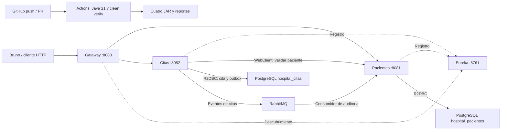
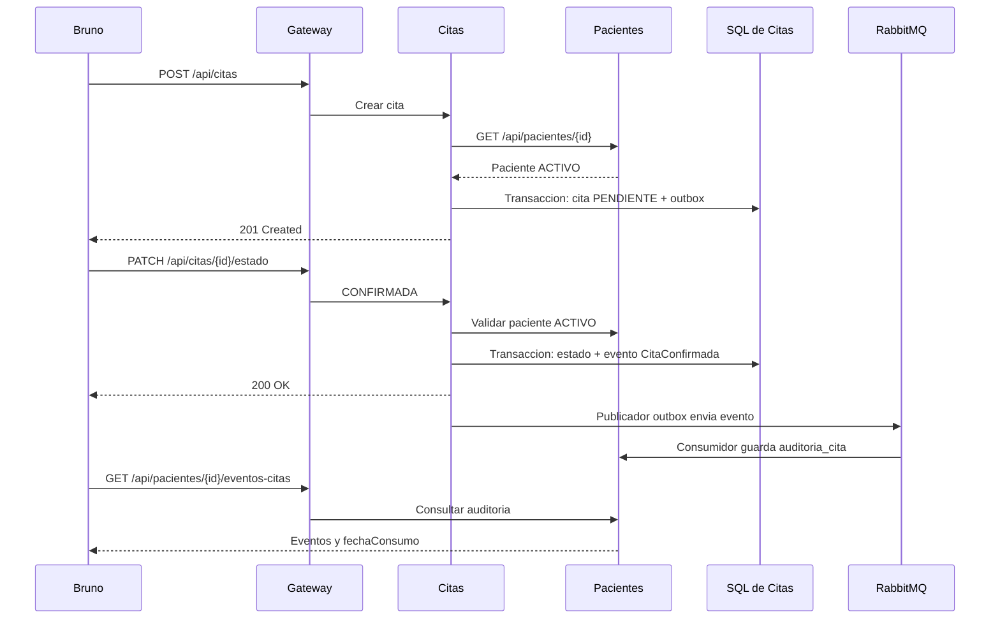

# Documento tecnico - Hospital Vida Salud

Estudiante: Carlos-C-Uribe (usuario de GitHub; completar el nombre academico).
Curso: Desarrollo de Aplicaciones Web II. Evaluacion T2.
Alcance ampliado aprobado: Pacientes y Citas.

## 1. Problema y objetivo

El monolito hospitalario mezcla responsabilidades y dificulta mantener y publicar cambios.
La solucion separa el registro de pacientes de la programacion administrativa de citas.
El objetivo verificable es registrar un paciente, validarlo desde Citas, reservar y confirmar
una cita, publicar el evento y consultar su auditoria consumida en Pacientes.
GitHub Actions compila y prueba los cuatro modulos de la solucion.

## 2. Actores

| Actor | Operacion |
|---|---|
| Admision | Registrar y actualizar pacientes, programar y reprogramar citas |
| Paciente ficticio | Consultar su cita y solicitar su cancelacion |
| Personal autorizado | Consultar datos y registrar ATENDIDA o AUSENTE de forma administrativa |
| Administrador | Revisar salud de servicios, Eureka y RabbitMQ |
| Desarrollador | Mantener codigo, pruebas y CI |

Los actores describen el negocio; esta version local no implementa autenticacion.
Se utiliza informacion ficticia, sin diagnosticos, tratamientos ni historias clinicas.

## 3. Limites y propiedad de datos

| Aplicacion | Responsabilidad y propiedad |
|---|---|
| pacientes-service | Datos maestros del paciente; auditoria de sus cambios y copia de los eventos de citas |
| citas-service | Datos de citas, estados, reservas de agenda y eventos pendientes |
| api-gateway | Entrada HTTP, rutas y descubrimiento de destinos |
| eureka-server | Registro de instancias; no procesa operaciones de negocio |

Citas guarda paciente_id, sin acceso SQL a las tablas de Pacientes.
La auditoria_cita de Pacientes es una copia historica derivada de eventos. Pacientes no
modifica las citas ni su estado; Citas sigue siendo propietario de esas decisiones.
Se mantiene auditoria dentro de Pacientes para limitar el alcance a dos servicios de negocio.
Se demuestra comunicacion asincrona real entre Citas y Pacientes.

## 4. Arquitectura



Eureka mantiene el registro. Las solicitudes de negocio van directamente desde Gateway
al servicio descubierto; no atraviesan Eureka.
Compose mantiene las bases y AMQP internos. Gateway, Eureka y la consola RabbitMQ se
publican solo en 127.0.0.1.

## 5. Comunicacion del flujo



Las flechas de respuesta hacia Bruno resumen la respuesta HTTP a traves del Gateway.
El HTTP valida inmediatamente una referencia necesaria para la reserva.
RabbitMQ transporta el registro secundario de auditoria sin hacer depender la respuesta
HTTP de la disponibilidad del consumidor.

## 6. Datos SQL y R2DBC

Base hospital_pacientes:
- paciente: ID, documento ficticio, nombres, apellidos, nacimiento, contacto, direccion,
  fechas, estado ACTIVO/INACTIVO y version.
- outbox: eventos originales de pacientes.
- auditoria: historial recibido de eventos originales.
- auditoria_cita: evento_id unico, cita_id, codigo_cita, paciente_id, tipo, estados, horario,
  fecha del evento, fecha de consumo y origen.

Base hospital_citas:
- cita: ID, codigo unico, paciente_id, especialidad, fecha_hora, profesional_codigo,
  motivo, estado, fechas y version.
- outbox: UUID, routing_key, payload, enviado, intentos y siguiente_intento.

No hay claves foraneas entre las bases. Las auditorias conservan IDs historicos aun cuando
un paciente se elimina. Los indices permiten consultar por paciente, estado y fecha.
Los indices unicos parciales de citas protegen paciente/horario y profesional/horario
para todas las citas excepto CANCELADA.
Una cancelacion libera el horario; una reprogramacion reemplaza la reserva anterior.
Las pruebas de horarios ocupados y reservas simultaneas de Citas se omiten por instruccion
del estudiante; sus reglas y restricciones SQL permanecen.

schema.sql se ejecuta con la inicializacion SQL de Spring Boot sobre R2DBC.
La ampliacion de Pacientes agrega solamente una tabla e indice mediante CREATE IF NOT EXISTS.
No se requiere borrar los datos anteriores. Para futuros cambios de esquema se deberia
incorporar un mecanismo de migraciones.

## 7. Reglas de Pacientes

- Documento ficticio unico por tipo y numero, protegido tambien por SQL.
- Tipos: DEMO, DNI_FICTICIO o PASAPORTE_FICTICIO.
- Numero: DEMO- seguido de letras mayusculas, numeros o guiones.
- Telefono ficticio: DEMO- seguido de numeros.
- Nombres y apellidos obligatorios, correo valido y nacimiento anterior a hoy.
- PUT reemplaza los campos editables.
- DELETE elimina fisicamente al paciente; GET posterior devuelve 404.
- Las auditorias permanecen consultables.
- Un documento puede reutilizarse despues de eliminar fisicamente su registro.

## 8. Reglas de Citas y supuestos de agenda

- pacienteId positivo, paciente existente y ACTIVO al crear, reprogramar y confirmar.
- ID, codigo, fechas administrativas y version generados por el sistema.
- El paciente asociado a una cita no se cambia mediante PUT.
- Fecha futura, lunes a sabado, zona UTC-5.
- Duracion fija de 30 minutos; inicio entre 08:00 y 17:30, minutos 00 o 30.
- Profesional ficticio con prefijo DEMO-, especialidad y motivo administrativo obligatorios.
- Creacion siempre en PENDIENTE.
- Reprogramacion solo de PENDIENTE/CONFIRMADA antes del inicio original.
- Todo PUT aceptado devuelve la cita a PENDIENTE y publica CitaReprogramada.
- Confirmacion antes de la fecha de cita.
- ATENDIDA y AUSENTE desde el horario de cita.
- DELETE cancela y conserva la fila. Repetir la cancelacion devuelve 204.
- Repetir el estado actual devuelve la cita sin publicar otro evento.
- CANCELADA, ATENDIDA y AUSENTE son estados finales.

| Origen | Destinos |
|---|---|
| PENDIENTE | CONFIRMADA, CANCELADA, AUSENTE |
| CONFIRMADA | ATENDIDA, CANCELADA, AUSENTE |
| CANCELADA / ATENDIDA / AUSENTE | Ninguno |

ATENDIDA es solo un estado administrativo de la cita; el alcance no registra una atencion clinica.

Si el paciente pasa a INACTIVO o se elimina, se bloquean nuevas reservas, reprogramaciones
y confirmaciones. Las citas existentes se conservan y pueden cancelarse.
No hay cancelacion automatica por cambios del paciente.

La validacion HTTP y la escritura local no forman una transaccion distribuida.
Existe un intervalo entre validar al paciente y guardar la cita; se documenta como limite
academico de consistencia entre servicios.

## 9. Contratos HTTP

| Metodo | Ruta | Resultado |
|---|---|---|
| POST | /api/pacientes | 201 + Location |
| GET | /api/pacientes | 200 + lista paginada |
| GET | /api/pacientes/{id} | 200; 404 |
| PUT | /api/pacientes/{id} | 200; 400; 404; 409 |
| DELETE | /api/pacientes/{id} | 204; 404 |
| GET | /api/pacientes/{id}/eventos | 200 + historial de paciente |
| GET | /api/pacientes/{id}/eventos-citas | 200 + auditoria recibida de citas |
| POST | /api/citas | 201 + Location |
| GET | /api/citas | 200; filtros pacienteId y estado opcionales |
| GET | /api/citas/{id} | 200; 404 |
| PUT | /api/citas/{id} | 200 + cita PENDIENTE |
| PATCH | /api/citas/{id}/estado | 200 + cita actualizada |
| DELETE | /api/citas/{id} | 204; cancela conservando historia |

Listados: page desde 0, size entre 1 y 100, por defecto 20.
Errores: fecha, status, codigo y mensaje.
400: datos/horario invalido; 404: cita o paciente inexistente;
409: paciente inactivo, transicion invalida, horario ocupado o modificacion concurrente;
503: no se pudo consultar Pacientes dentro del tiempo permitido; 500: error interno generico.

Los errores de Pacientes se traducen por significado; no se filtra su respuesta interna.
El uso de @Version detecta cambios concurrentes en SQL, pero el contrato HTTP no implementa ETag/If-Match.

## 10. Comunicacion sincrona

Gateway usa lb://pacientes-service y lb://citas-service.
Citas usa WebClient con ReactorLoadBalancerExchangeFilterFunction y http://pacientes-service,
resuelto con Eureka. El timeout de validacion por defecto es 3 segundos.
Gateway tiene 3 segundos para conectar y 5 segundos para respuesta.
Se evita mantener abierta una transaccion SQL durante la consulta HTTP.
No se reintentan automaticamente escrituras HTTP.

La prueba CitasIT usa descubrimiento estatico aislado y arranca un proceso real de Pacientes.
La demostracion de Compose utiliza Eureka real.

## 11. RabbitMQ

| Elemento | Pacientes | Citas |
|---|---|---|
| Exchange topic durable | hospital.pacientes | hospital.citas |
| Binding | paciente.* | cita.* |
| Cola durable | pacientes.auditoria | pacientes.citas.auditoria |
| Productor | Pacientes | Citas |
| Consumidor | Pacientes | Pacientes |
| DLX direct | hospital.pacientes.dlx | hospital.citas.dlx |
| DLQ | pacientes.auditoria.dlq | pacientes.citas.auditoria.dlq |

Eventos de Citas: CitaCreada, CitaReprogramada, CitaConfirmada, CitaCancelada,
CitaAtendida y CitaAusente. Routing keys: cita.creada, cita.reprogramada,
cita.confirmada, cita.cancelada, cita.atendida, cita.ausente.

Contrato JSON version 1:
```json
{
  "version": 1,
  "eventoId": "00000000-0000-0000-0000-000000000001",
  "tipo": "CitaConfirmada",
  "citaId": 1,
  "codigoCita": "CITA-DEMO",
  "pacienteId": 1,
  "estadoAnterior": "PENDIENTE",
  "estadoNuevo": "CONFIRMADA",
  "fechaHora": "2027-01-04T10:00:00-05:00",
  "fecha": "2027-01-03T10:00:00-05:00",
  "origen": "citas-service"
}
```

No contiene nombres, documentos, correos ni motivos clinicos.
El publicador revisa outbox cada 2 segundos, envia un mensaje persistente,
espera publisher confirm y verifica que no haya sido devuelto por falta de ruta.
Solo entonces marca enviado=true. Reintenta con espera creciente hasta 60 segundos.
No hay limite total de intentos. Es una entrega al menos una vez; no se promete orden global.
El consumidor valida el contrato y utiliza evento_id unico con ON CONFLICT DO NOTHING
para no duplicar el historial. Su Mono termina despues de persistir; Spring AMQP gestiona
el reconocimiento manual. Los mensajes rechazados van a DLQ, que requiere revision manual.

## 12. Programacion reactiva

Mono: consulta individual, creacion, cambio y operaciones sin contenido.
Flux: listas de pacientes, citas, auditoria y eventos pendientes.
WebClient, servicios, repositorios y SQL forman flujos reactivos.
Las operaciones de negocio no usan block, JDBC ni JPA.
RabbitTemplate es bloqueante; el publicador lo ejecuta en boundedElastic, fuera del hilo HTTP.
Las esperas bloqueantes se limitan a las pruebas y scripts de demostracion.

## 13. Pruebas e integracion continua

Las pruebas unitarias de Citas usan un reloj fijo para evitar dependencia de la fecha real.
Verifican registro, paciente activo/inactivo, fechas, transiciones, cancelacion, reprogramacion,
inexistencia, paginacion e idempotencia de cambio de estado.
Las pruebas de WebClient verifican contrato, 404, 409, 503 y timeout.
Las pruebas de controlador verifican HTTP, Location y validacion de entrada.
CitasIT arranca dos bases, RabbitMQ y Pacientes real; comprueba persistencia, validacion HTTP,
eventos consumidos, historia tras eliminar paciente y rollback de cita/outbox.

No se incluyen pruebas de horario ocupado ni reservas simultaneas de Citas.
Se conservan las pruebas existentes de Pacientes, incluida la proteccion del documento unico.

Surefire ejecuta *Test y Failsafe ejecuta *IT. El workflow ejecuta clean verify desde la raiz
ante push y PR hacia main. Si una prueba falla, el job falla y no publica los ejecutables
como un resultado exitoso. Los reportes se guardan incluso en caso de fallo.
El fallo controlado se activa mediante DEMO_CI_FAILURE y se corrige en una rama de trabajo.
El resultado real de cada comprobacion esta en ESTADO_VERIFICACION.md.

## 14. Entrega y limites

README, documento tecnico, diagramas, solicitudes HTTP, coleccion Bruno, scripts y workflow
se versionan. .env, .git, .vs y target no forman parte del ZIP de entrega.
Los secretos locales se mantienen fuera del repositorio.
El proyecto es local y academico: no incorpora despliegue automatico ni decisiones clinicas.
Las capturas y las ejecuciones de Actions deben obtenerse del proyecto real.

Fuentes tecnicas:
- WebClient reactivo y descubrimiento: https://docs.spring.io/spring-cloud-commons/reference/spring-cloud-commons/common-abstractions.html
- R2DBC: https://docs.spring.io/spring-data/relational/reference/r2dbc.html
- RabbitMQ: https://www.rabbitmq.com/docs
- GitHub Actions: https://docs.github.com/en/actions/get-started/continuous-integration
- Bruno: https://docs.usebruno.com/bru-lang/overview
